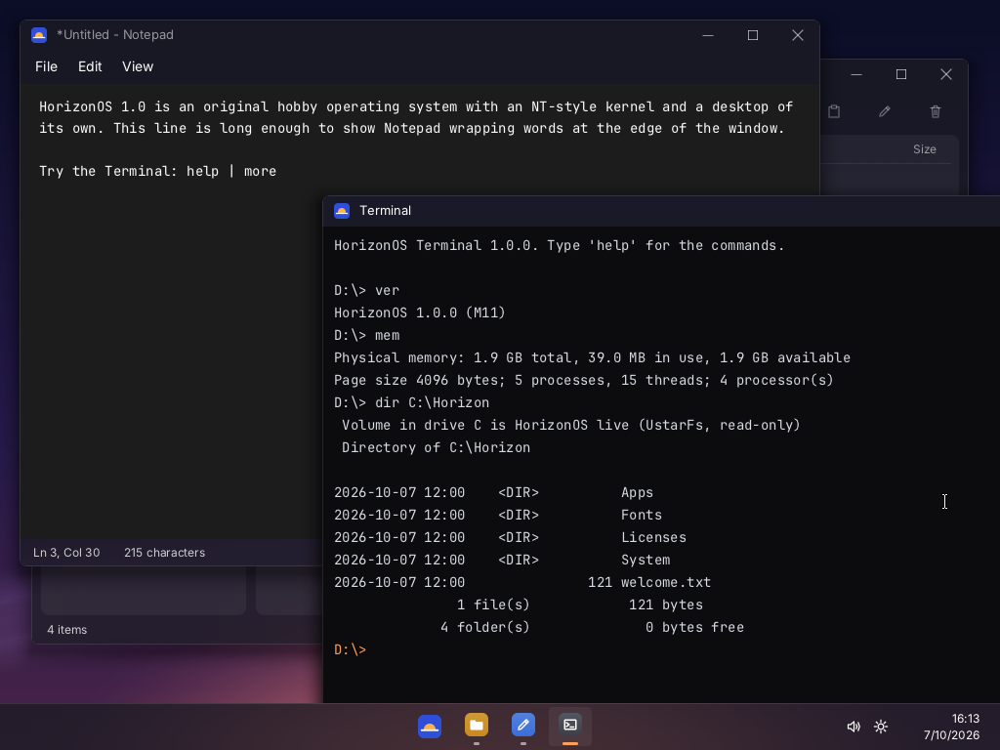
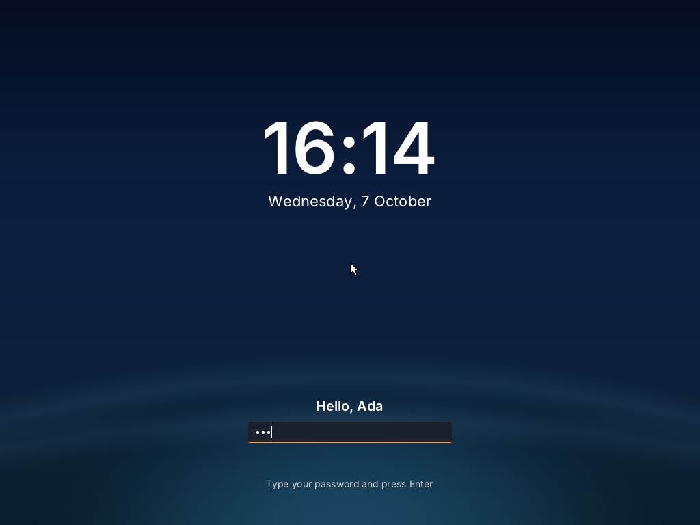
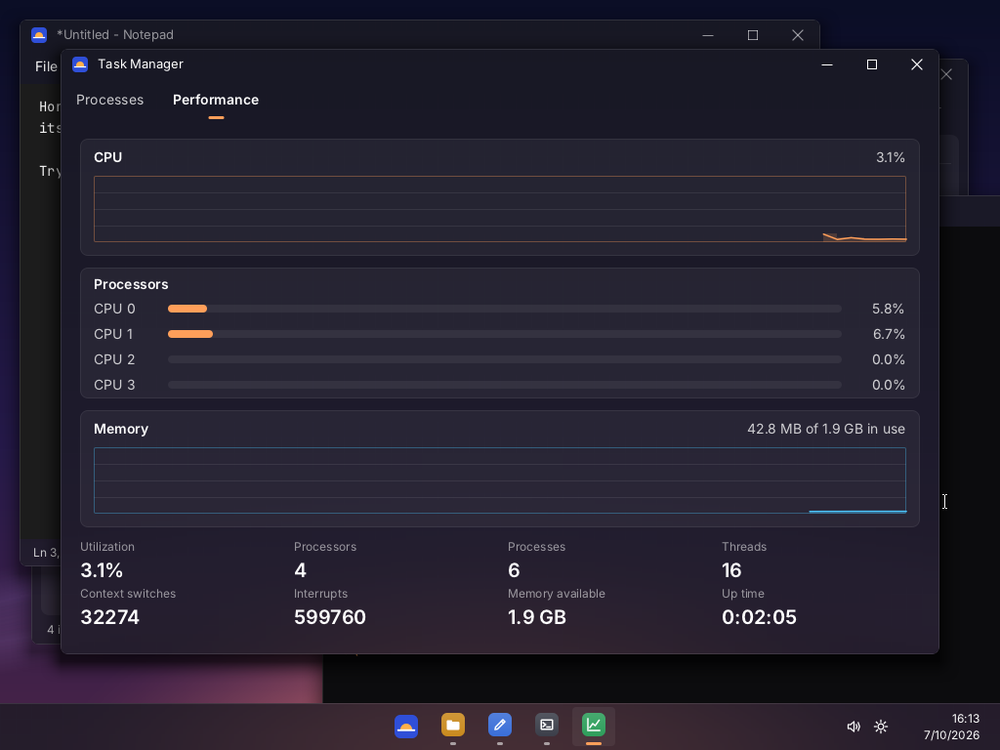
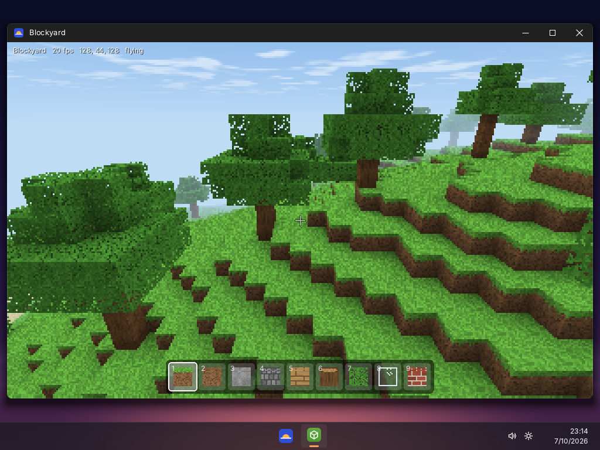
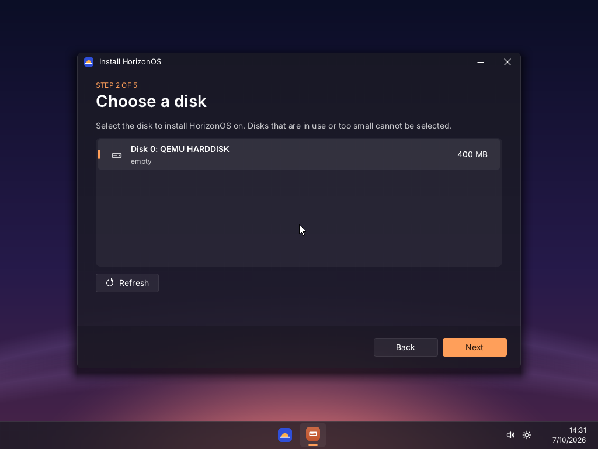
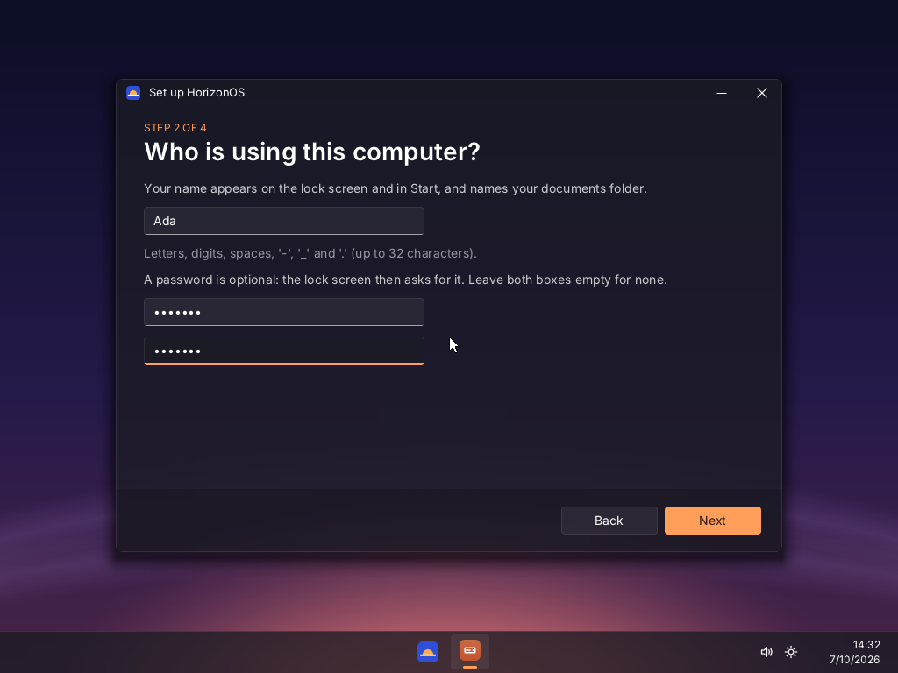
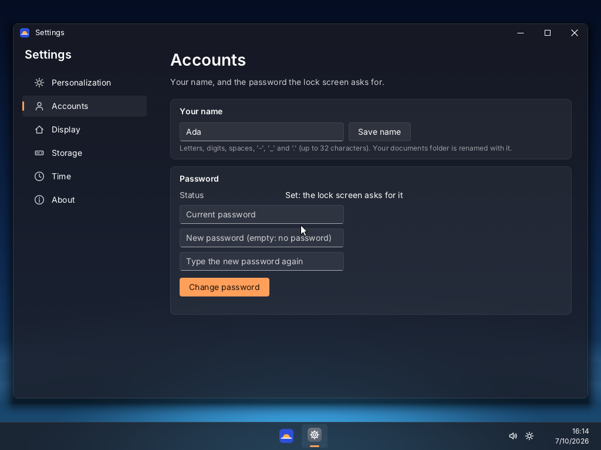

# Nexora OS


An original hobby operating system for x86-64 UEFI PCs. Its kernel is structured like
Windows NT (HAL, Ke, Mm, Ob, Ps, Io, Ex, win32k), and its desktop is inspired by the look of
Windows 11. It is written in C, C++, Rust and assembly, and it boots in VirtualBox and QEMU. It
contains no Microsoft code or assets: the name, logo, icons and wallpapers are its own, and the
interface font is Inter (SIL Open Font License).

**Status: version 1.1.0.** The roadmap ended with 1.0.0 (M11); 1.1.0 (M12) added Blockyard, a
block-building game.



## What is in it

- **Kernel:** a HAL (GDT/TSS/IDT, ACPI, Local and I/O APICs, calibrated timers), a symbolized
  stop screen, a memory manager (PFN database, W^X kernel page tables, demand-zero paging,
  guarded stacks, a checksummed pool), preemptive threads with 32 priorities and cycle-based
  quanta, NT-style waits, events, semaphores, mutexes, timers and DPCs, an object manager with
  handles and a namespace, processes in their own address spaces running PE32+ programs, and an
  I/O manager with IRPs.
- **Multiprocessor:** every processor the firmware reports (up to 8) runs threads: one ready
  queue shared under the dispatcher lock, thread affinity, inter-processor interrupts for
  rescheduling, TLB shootdown and stopping the others at a crash.
- **Hardware:** PCI, an initial Intel 82540EM (VirtualBox E1000) Ethernet driver, AHCI SATA disks
  with GPT partitions, PS/2 keyboard and mouse, the CMOS clock, ACPI power off and reset, the UEFI
  framebuffer.
- **File systems:** a read-only C: from the boot ramdisk on the live system, and read/write
  FAT32 with long file names (write-back FAT cache, multi-cluster transfers).
- **Desktop:** win32k's windows, message queues and input routing, a compositor with Mica-like
  translucency, rounded corners, soft shadows and an eased desktop reveal; hzui, a C++ toolkit
  drawn in user mode with shared Inter body, large-body, display and technical-text font roles,
  cached font files and fallback faces; the shell with a timezone-aware lock-screen clock
  (optionally with a password), animated taskbar hover and active-window feedback, Start with
  search, quick settings, Alt+Tab, a clipboard, and consistent themed right-click menus. The
  supplied photographs in `assets/Wallpapers` are packaged with the system; Settings can choose
  independent desktop and lock-screen images. Accounts with a password get a separate sign-in
  layout with network, accessibility and power controls; password-free sessions keep the existing
  clock-first lock screen.
  App shortcuts can be pinned independently of Start's app tiles, and those taskbar pins are
  saved in user settings.
- **Programs:** Notepad (word wrap, find, undo), Files (copy, cut, paste and delete of whole
  folders, with item context menus), Terminal (built-in commands, console programs, `> file`, `| more`, line wrapping),
  Calculator, Clock, Calendar, Stopwatch, System Information, Paint (mouse drawing and BMP export),
  Browser (native shell with address entry, history, bookmarks, downloads listing and local
  text/HTML file loading through absolute paths or file URLs; HTML uses a bounded text parser,
  while remote page loading and CSS layout are not yet supported), Settings (searchable
  Home and category navigation, wallpaper, account credentials, display/storage/network status,
  time zone, About and diagnostics; sound controls, USB/Bluetooth, and display scaling are clearly
  marked unavailable because their system APIs are not implemented), Task Manager (processes,
  per-processor load), Setup, which installs Nexora OS on a disk, and Blockyard. New native app
  source directories are discovered by the build automatically and checked against their manifests.
  The shell loads the app catalog from `C:\Nexora\Apps`.
- **Blockyard:** an original 3D block-building game. The world is generated and saved to your
  documents. You can walk, swim and fly, and break and place nine kinds of blocks. It is drawn by
  a software raycaster on every processor, with ambient occlusion, water, glass, clouds, and
  textures generated in code. The window manager's new mouse lock gives it mouse-look.
- **Robustness:** a crashing program ends alone and the shell says which one; if the shell
  itself dies, the session starts it again; at shutdown programs are asked to close (Notepad
  asks about unsaved work) before the volumes are flushed.

## Walkthrough

### 1. Live system

Build the ISO (below) or take `build/nexora-os.iso`, and start it in a UEFI virtual machine
(VirtualBox: `scripts/create-vbox-vm.sh build/nexora-os.iso --wipe-disk --start`). After the boot
menu, the kernel displays the Nexora logo and a small animated dotted spinner on black; the
desktop fades in when it is ready. The desktop opens on the lock screen. Press any key.



The live system runs from memory: C: is the read-only system image, so settings are not kept.
Open Start with the logo key (or click the logo on the taskbar) and type to search; try the
Terminal (`help`, `dir C:\Nexora\System | more`, `ps`), Files, Notepad and Task Manager.



For a break, open **Blockyard** from Start and click into the window to capture the mouse:
W A S D and the mouse to move and look, left and right buttons to break and place, 1-9 to choose
a block, F to fly, Esc to let go of the mouse.



### 2. Install

In Start, choose **Install Nexora OS**. Setup lists the disks; pick one (it is erased; at least
230 MB), confirm, and wait for the copy (about two seconds in QEMU). Setup partitions the disk
(GPT: an EFI system partition and a FAT32 system partition), installs the boot loader and copies
the system. Then restart without the ISO (VirtualBox:
`scripts/create-vbox-vm.sh --boot-disk --start`).



### 3. First boot

The first start from the disk opens first-boot setup instead of the lock screen: your name, an
optional password (stored as a salted hash) and a wallpaper. Your documents folder is
`C:\Users\<name>\Documents`; Notepad, Files and the Terminal start there.



From then on the lock screen greets you by name and, with a password, asks for it. Settings >
Accounts changes the name and the password, Settings > Time the time zone the clocks show, and
Start > Power has Lock, Restart and Shut down.



## Build

Either use Docker:

```sh
scripts/build.sh iso          # builds the container once, then build/nexora-os.iso
```

or build natively on Linux / WSL2. The pinned LLVM, Rust and Limine install without root:

```sh
sudo apt install make git curl xz-utils gcc libc6-dev nasm xorriso mtools gdisk dosfstools qemu-system-x86 ovmf python3 python3-pil
make toolchain                # ~/.nexora-os-toolchain (about 1.4 GB)
make iso
```

## Run and test

```sh
make run                # QEMU + OVMF, serial on stdio (QEMU_SMP=4 make run: four processors)
make test               # headless boot tests: boot, desktop, shell, apps, SMP, recovery, install,
                        # boot from disk, accounts, diagnostics, input, power; screenshots in build/test/
python3 scripts/smoke-test.py --case catalog-apps  # launch the expanded built-in app catalog
python3 scripts/smoke-test.py --case network-interface  # probe the E1000 driver in QEMU
QEMU_SMP=4 make test    # the same on four processors
make testdisk           # build/test/disk.img: the GPT + FAT32 test disk (make run and make test attach it)
make vbox               # create or refresh the VirtualBox VM "Nexora OS" with the new ISO
```

Nexora currently runs its own statically linked PE32+ applications. It does not yet provide
general Windows application compatibility or a Linux ELF/syscall runtime; those require separate
loader and API work and are not implied by the native app catalog. Files and Terminal can launch
Nexora-compatible `.exe` programs, but Windows executables that import DLLs are not supported yet.
The native Nexora Browser shell can open local text and HTML files using an absolute path or a
`file:///C:/...` URL; HTML is rendered as bounded text with scripts and styles disabled. The kernel
provides a bounded DNS A-record lookup syscall for native apps, including ARP next-hop resolution
and serialized DNS-over-UDP access through the configured interface. The Browser can resolve a
host but does not yet fetch remote pages: application TCP connections, HTTP, and verified HTTPS/TLS
are not implemented. The Intel E1000 driver can initialize VirtualBox's PRO/1000 MT Desktop
adapter, and the bounded DHCPv4 client requests and reports an IPv4 address, gateway, and DNS server.
Firefox also requires DLL loading and Windows API support that Nexora does not provide. The
`network-interface` smoke case exercises the E1000 driver and DHCP handshake on QEMU user-mode NAT;
the `dns-api` smoke case also exercises a real DNS A lookup through the app-facing syscall. Neither
test verifies HTTP/HTTPS page loading or general browser Internet access.

On Windows, run these from a WSL2 shell in the checkout; `make vbox` drives the Windows
VirtualBox through `VBoxManage.exe`. The VM logs COM1 to `serial-com1.log` in its VM folder.
`scripts/create-vbox-vm.sh --cpus 2` gives the VM two processors; the script also sets the VM's
TSC mode, which multi-processor guests need on VirtualBox's Hyper-V backend (see
[docs/PROGRESS.md](docs/PROGRESS.md), known issues).

## Layout

`hal/ ke/ mm/ ob/ ps/ io/ ex/ rtl/ init/` kernel (C17 + NASM) · `win32k/` window manager
(C++20) with `win32k/rgn/` region library (Rust) · `drivers/` · `user/` user-mode libraries
(hzsys, hzrt, hzuser, hzui) and programs (C++20, PE32+) · `tools/` host tools · `third_party/`
vendored, pinned dependencies (see [THIRD_PARTY_NOTICES.md](THIRD_PARTY_NOTICES.md)).

How it works: [docs/ARCHITECTURE.md](docs/ARCHITECTURE.md). What was built, milestone by
milestone, and what is known not to work: [docs/PROGRESS.md](docs/PROGRESS.md).
